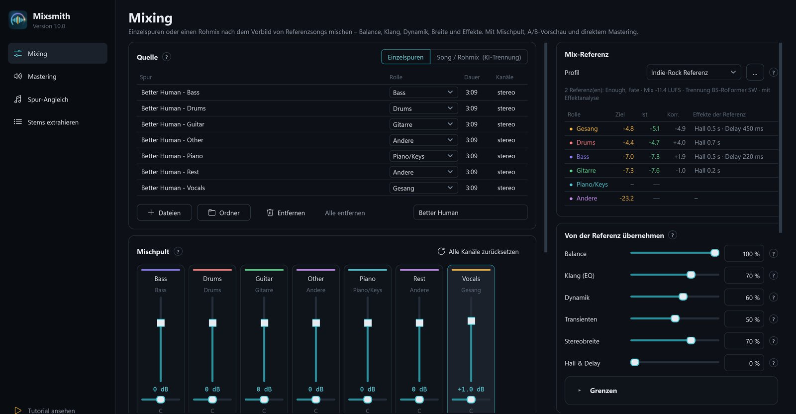
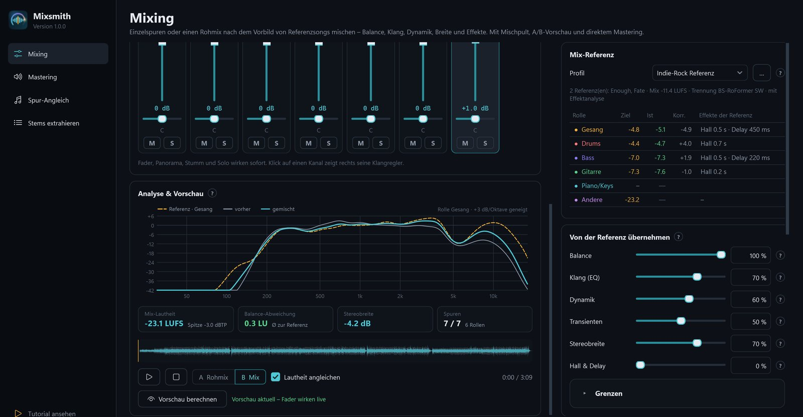
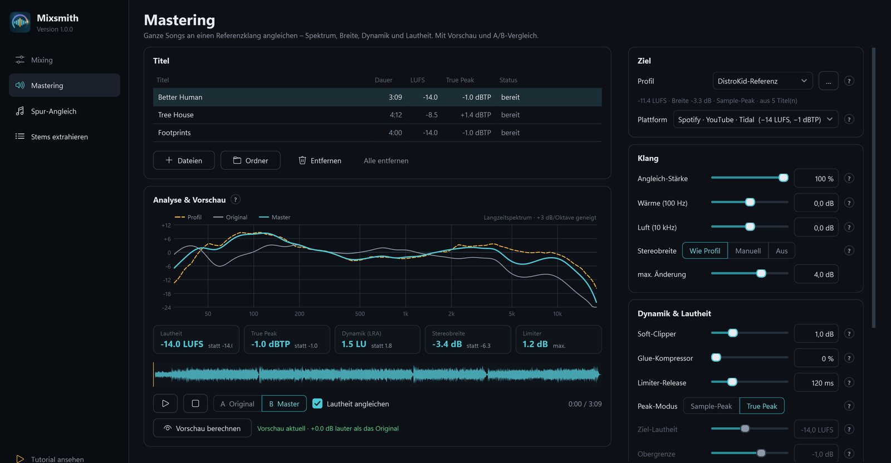

<p align="center">
  
</p>

<h1 align="center">Mixsmith</h1>

<p align="center">
  <b>Mischen und Mastern nach dem Vorbild von Songs, deren Klang dir gefällt.</b><br>
  Mit Mischpult, A/B-Vorschau und KI-Stem-Trennung. Für Windows, Linux und macOS.
</p>

<p align="center">
  <a href="https://kieselwerk.itch.io/mixsmith"></a>
  <a href="https://www.paypal.com/cgi-bin/webscr?cmd=_xclick&business=kay.seufferheld%40gmx.de&item_name=Spende+f%C3%BCr+Mixsmith&currency_code=EUR&no_shipping=1"></a>
  <a href="LICENSE"></a>
  
  
</p>

<p align="center">
  
</p>

Mixsmith misst Referenzsongs Spur für Spur und überträgt Balance, Klang, Dynamik, Stereobreite sowie Hall und Delay auf den eigenen Song. Alles läuft lokal auf dem eigenen Rechner, ohne Konto und ohne Upload.

## Was Mixsmith kann

| Bereich | Was er tut |
|---|---|
| **Mixing** | Einzelspuren oder einen fertigen Rohmix nach einer Referenz mischen. Mischpult mit Fadern, Panorama, Stumm und Solo, die live während der Vorschau wirken, dazu Kanal-EQ, Kompressor und Hall. |
| **Mastering** | Fertige Songs an einen Referenzklang angleichen: Restauration, Stem-Balance, Spektrum, Stereobild, Glue, Soft-Clipper, Limiter und Lautheit. Zielvorgaben für Streaming, Apple Music, Club und CD. |
| **Spur-Angleich** | Eine rohe Instrumentenspur klingt wie das Instrument aus Referenzsongs. |
| **Stems extrahieren** | Songs per KI in Einzelspuren zerlegen: BS-RoFormer, Demucs, Gesang/Instrumental und DrumSep. |
| **Tutorial** | Zweieinhalb Minuten Video, in dem das Maskottchen Mixi die wichtigsten Funktionen zeigt. |

## So funktioniert es

1. **Referenz anlernen.** Ein bis fünf Songs wählen, deren Mix gefällt. Die KI zerlegt sie in Gesang, Drums, Bass, Gitarre, Keys und Rest und misst jede Rolle: Pegel im Mix, Klangfarbe, Dynamik, Breite, Hall und Delay.
2. **Eigene Spuren laden.** Einzelspuren hineinziehen, die Rolle erkennt Mixsmith am Dateinamen. Oder einen fertigen Stereomix, den die KI vorher zerlegt.
3. **Anhören und fertigstellen.** Vorschau berechnen, zwischen A und B umschalten, am Mischpult nachregeln. Am Ende stehen Mix und Master als WAV bereit.

<p align="center">
  
  
</p>

## Download

Mixsmith ist kostenlos. Wer die Entwicklung unterstützen möchte, kann beim Download auf [itch.io](https://kieselwerk.itch.io/mixsmith) etwas geben.

| Paket | Inhalt |
|---|---|
| **Windows** (`Mixsmith-1.0.1-Windows-Setup.exe`) | Installer für Mixing von Einzelspuren, Mastering und Spur-Angleich. Ohne KI-Trennung. |
| **Linux** (`Mixsmith-1.0.1-Linux.tar.gz`) | `./install.sh`, mit KI-Trennung: `./install.sh --ki` |
| **macOS** (`Mixsmith-1.0.1-macOS.zip`) | Rechtsklick auf „Mixsmith installieren.command“ → „Öffnen“, fragt nach der KI-Trennung. Python 3.10 oder neuer. |
| **Quelltext** (`Mixsmith-1.0.1-Quelltext.zip`) | Dieser Stand des Repositorys. |

**KI-Trennung:** Die KI-Software (PyTorch und audio-separator, etwa 3 GB) installieren die Linux- und macOS-Installer auf Wunsch mit. Unter Windows lässt sie sich aus dem Quelltext nachrüsten (siehe unten). Die KI-Modelle lädt Mixsmith beim ersten Einsatz einmalig aus den Quellen ihrer Autoren herunter. Danach läuft alles offline.

### Warum warnen Windows und macOS beim ersten Start?

Mixsmith ist noch nicht digital signiert. Windows meldet deshalb „Der Computer wurde durch Windows geschützt“, macOS einen nicht verifizierten Entwickler. Das ist keine Virenmeldung: Der komplette Quelltext liegt hier offen, und die Installer baut GitHub direkt aus diesem Repository.

Eine Signatur kostet Geld, das ich als Einzelentwickler selbst bezahlen müsste: etwa 50 bis 70 € im Jahr für ein Windows-Zertifikat und 99 $ im Jahr für das Apple-Entwicklerkonto. Spenden fließen zuerst in diese Signaturen, dann verschwinden die Warnungen.

- **Windows:** „Weitere Informationen“ → „Trotzdem ausführen“.
- **macOS 15 und neuer:** Mixsmith einmal öffnen, dann Systemeinstellungen → Datenschutz & Sicherheit → „Dennoch öffnen“. Bis macOS 14: Rechtsklick → „Öffnen“.
- **Linux:** keine Warnung. Das AppImage einmal ausführbar machen.

### Unterstützen

Mixsmith ist kostenlos. Wer die Entwicklung und die Signaturen unterstützen möchte: [per PayPal spenden](https://www.paypal.com/cgi-bin/webscr?cmd=_xclick&business=kay.seufferheld%40gmx.de&item_name=Spende+f%C3%BCr+Mixsmith&currency_code=EUR&no_shipping=1) oder beim Download auf [itch.io](https://kieselwerk.itch.io/mixsmith).

## Systemanforderungen

| | Mindestens | Empfohlen für die lokale KI |
|---|---|---|
| Betriebssystem | Windows 10 (64 Bit), Ubuntu 22.04, macOS 12 | Windows 11, macOS 14 mit Apple Silicon |
| Prozessor | x64 mit AVX2 oder Apple M1, 4 Kerne | 8 Kerne |
| Arbeitsspeicher | 8 GB | 16 GB |
| Speicherplatz | 8 GB frei | SSD mit 8 GB frei |
| Grafikkarte | nicht nötig, die KI läuft dann auf dem Prozessor | NVIDIA ab 4 GB Grafikspeicher |

Gemessen mit einer RTX 3070: einen Song von 4 Minuten zerlegen etwa 40 Sekunden, ein Mix-Profil aus einem Song etwa 1 Minute (mit Effektanalyse etwa 2), 7 Spuren mischen und mastern etwa 30 Sekunden.

## Selbst starten und bauen

```bash
pip install -r requirements.txt
python mixsmith.py
```

Für die KI-Trennung zusätzlich `pip install "audio-separator[gpu]"` (NVIDIA) oder `"audio-separator[cpu]"`.

```bash
python build.py setup      # Windows-Installer ohne KI (PyInstaller + Inno Setup 6)
python build.py light      # Mixsmith.exe ohne KI, portabel
python build.py full       # Windows-Setup mit KI (rund 3 GB)
python build.py source     # Quelltext-Zip
python packaging/make_unix_packages.py   # Linux- und macOS-Pakete
```

Kommandozeile, Messverfahren, KI-Effektanalyse und Grenzen: [docs/TECHNIK.md](docs/TECHNIK.md) · Änderungen: [docs/AENDERUNGEN.md](docs/AENDERUNGEN.md)

## Grenzen

Mixsmith gleicht Messgrößen an, es hört nicht. Bei sehr unterschiedlichem Material lohnt es sich, die Übernahme auf 50 bis 70 Prozent zu stellen und mit A/B zu prüfen. Einzelspuren liefern sauberere Ergebnisse als ein zerlegter Rohmix.

## Lizenz

Copyright © 2026 Kay Seufferheld, Kieselwerk.
Mixsmith ist freie Software unter der [GNU General Public License v3](LICENSE). Alle Bibliotheken, KI-Modelle und ihre Lizenzen stehen in [LIZENZEN.md](LIZENZEN.md).
